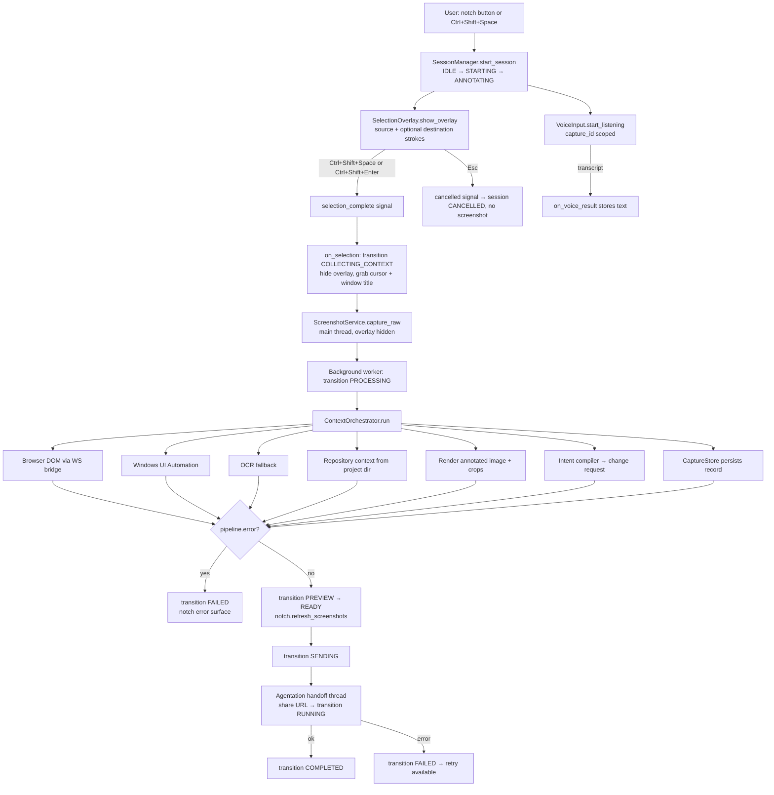
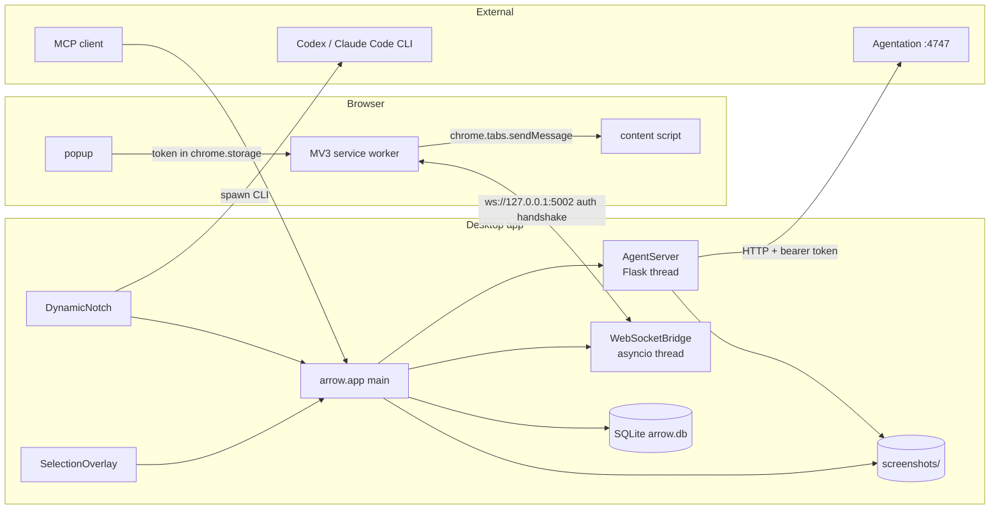

# Arrow Annotate — Current Architecture

_Last verified against the source tree on 2026-10-10. This document describes the
implementation as it exists, not an aspirational design._

## 1. Technology stack

| Layer | Technology |
| --- | --- |
| Language / runtime | Python 3.10+ (developed and tested on 3.12) |
| Desktop UI | PyQt6 (frameless floating notch + full-screen annotation overlay) |
| Local HTTP API | Flask (threaded) on `127.0.0.1:5001` by default |
| Local WebSocket bridge | `websockets` (asyncio loop in a daemon thread) on `127.0.0.1:5002` |
| Browser integration | Chrome Manifest V3 extension (`browser_extension/`) |
| Screen capture | `mss` + Pillow |
| Element resolution | Browser DOM (via extension), Windows UI Automation (`uiautomation`), OCR (RapidOCR) fallback |
| Voice input | `SpeechRecognition` + PyAudio (Google Web Speech by default — network) |
| Persistence | SQLite (`arrow.db`) via a small hand-rolled repository layer |
| Structured data | Pydantic models |
| Providers | Codex CLI, Claude Code CLI, Agentation HTTP service |
| MCP | In-process MCP server (`arrow/mcp/`) |

## 2. Entry points

- `main.py` — validates the platform (Windows-only guard), puts the repo root on
  `sys.path`, and calls `arrow.app.main`.
- `arrow/app.py:main()` — the single composition root: builds `QApplication`,
  starts `AgentServer`, builds the notch/overlay/voice/session objects, wires
  signals, registers the global hotkey, starts the status poll timer, and runs
  the Qt event loop.
- `arrow/mcp/server.py` — a separate MCP entry surface used by agent clients.

## 3. End-to-end capture flow (as implemented)

### State machine

`arrow/capture/session.py` owns the single active `CaptureSession` and validates
every transition in `ALLOWED_TRANSITIONS`. Terminal states (`COMPLETED`,
`FAILED`, `CANCELLED`) can only return to `IDLE`. Abort transitions to
`FAILED`/`CANCELLED` are allowed from any non-final active state.

## 4. Local services

### HTTP surface and guards

Every route below is wrapped by `require_capability` (origin check →
constant-time bearer-token verification → capability gate). Sensitive
capabilities are disabled by default and opt in through
`ARROW_ENABLED_CAPABILITIES`.

| Route | Capability | Notes |
| --- | --- | --- |
| `GET /status` | none | intentionally minimal unauthenticated payload; detail behind token |
| `GET /screenshot` | `read_screenshot` | on-demand primary-screen capture |
| `GET /screenshots/<path>` | `read_screenshot` **or** valid share token | Agentation uses share tokens |
| `POST /screenshots/save` | `read_screenshot` | validated, atomically written, collision-resistant name |
| `POST /resolve`, `POST /inspect`, `POST /highlight/resolve` | `read_capture_context` | DOM/UIA/OCR resolution |
| `POST /highlight/capture` | `read_screenshot` | region capture with normalized crop |
| `POST /execute`, `/execute/batch`, `/highlight/execute` | `control_native` (opt-in) | no shell execution is ever exposed |

### WebSocket bridge

The extension must send `{"type":"auth","token":…}` within `auth_timeout`
seconds; the socket is only registered after verification (close code `4001`
otherwise). `inspect(x, y)` is request/response with per-message ids and
timeouts.

## 5. Threading model

| Thread | Work | Rule |
| --- | --- | --- |
| Qt main | all widget access, state transitions triggered by UI | single owner of widgets |
| `AgentServer` | Flask WSGI | never touches widgets; returns HTTP only |
| `WSBridge` | asyncio loop for the extension socket | never touches widgets |
| capture worker | `ContextOrchestrator.run` | communicates back through queued Qt signals only |
| voice worker | microphone + recognition | generation-token cancellation; signals only |
| provider worker | CLI subprocess | `provider_finished` queued signal to UI |

A `QObject` signal bridge (`UiBridge`) is the only sanctioned way for background
threads to update the UI. Stale callbacks carry their `capture_id` and are
discarded when it no longer matches the active session.

## 6. Persistence

- All user data resolves through `arrow.core.config`, so `ARROW_HOME` moves it as
  a unit. Default `~/.arrow`.
- `arrow.db` (SQLite) — capture records, change requests. `ARROW_DB_PATH` overrides.
- `screenshots/` — annotated images and crops, named with collision-resistant ids.
- `captures/` — generated context files.
- `ARROW_HOME` also holds `token`, `config.json` (selected project), logs.

`resolve_screenshots_dir()` is the single source of truth shared by the capture
pipeline, the capture store and the HTTP screenshot routes, so a capture can
never be written to a directory the server will not serve. On first start,
`migrate_legacy_home()` moves a pre-`ARROW_HOME` checkout database into
`ARROW_HOME` exactly once, and skips entirely when a database already exists
there.

## 7. Shutdown

Normal exit unregisters the global hotkey, stops Qt timers, cancels voice and
capture workers, stops the WebSocket bridge and Flask server, releases the
microphone, and closes the database. Daemon threads are a backstop, not the
primary mechanism.
